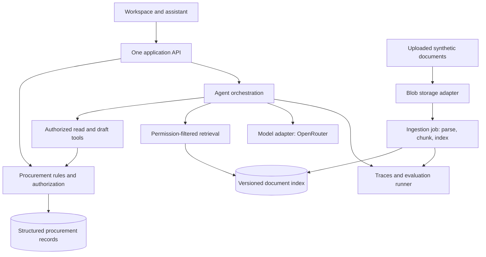
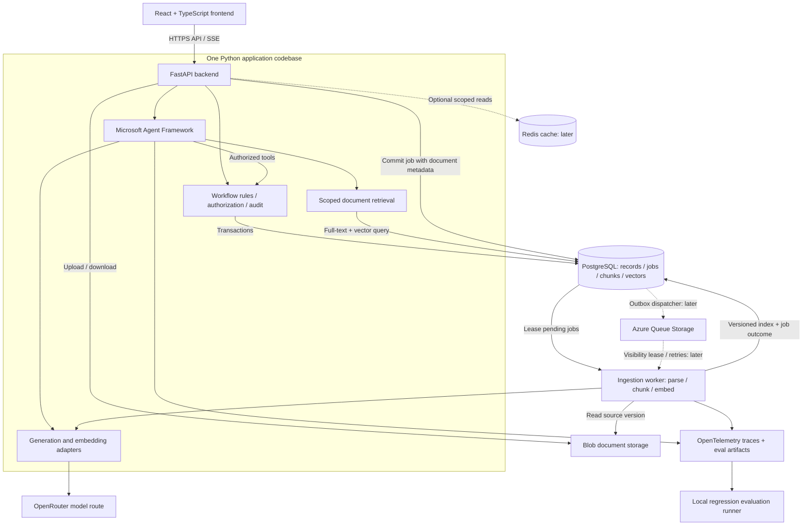

# Small-team architecture direction

Status: first-milestone architecture baseline accepted on 22 October 2026. React/TypeScript, Python/FastAPI, one in-process Microsoft Agent Framework agent, PostgreSQL/full-text/pgvector, Floci Blob storage, and database-backed ingestion jobs with one worker are the baseline. OpenRouter supplies hosted model access. Microsoft Foundry is deferred. Exact models, version compatibility and authentication contract details still require implementation decisions and verification. The seeded-user identity approach was accepted on 23 October 2026. The FastAPI/React application now implements seeded identity, durable PR/approval, PO issuance/reapproval, goods receipts/service acceptance and supplier invoice capture/review. Ingestion, agent tools/retrieval, RAG evaluations and cloud deployment remain pending.

## Purpose and first slice

Use a fictional marine procurement team to build a production-ready RAG-backed agent and practice Azure architecture locally through Floci. The business dataset is synthetic; the eventual retrieval, authorization, model execution, observability, and evaluation must be real. A successful UI demonstration alone does not establish production readiness.

Start with one purchase: Aina requests ten pump seals at MYR 200 each; Ben approves; Chloe issues the MYR 2,000 PO; Dinesh accepts six seals with four outstanding; Eva reviews a MYR 1,200 invoice for the six accepted seals. The agent answers "Why is this purchase still open?" using the live structured outstanding quantity and cited receipt/PO evidence. Invoice review does not close the four outstanding items, reconcile the purchase, or authorize payment. These example amounts exclude tax modelling, which is not yet specified.

The maintenance-service companion replaces quantities received with accepted milestones. Invoice capture may occur before goods receipt; receipt evidence is linked as it becomes available, and the reviewer can flag missing evidence. The main flow diagram shows the ordinary narrative, not a rule forbidding early invoice capture.

## Proposed initial shape

Keep workflow, agent, ingestion, and evaluation as modules in one Python codebase. Microsoft Agent Framework runs within the application process; the diagram's agent box denotes a logical module, not an additional service. Run one FastAPI application and one small ingestion job runner initially. Database-backed jobs can start small; use leases, bounded retries, and idempotent document-version keys so retries do not duplicate indexed content. No microservices, Kubernetes, distributed agent fleet, or event-stream platform is justified for this first slice.

Structured records own authoritative status, totals, outstanding quantities, approval rules, and permission checks. RAG provides document and policy evidence with document version, passage/page, and source identity. If an old PO conflicts with a revised order, the agent must show the revision and use current structured state. Document text cannot grant tool permissions or approve a purchase.

All state-changing tools require server-side identity, authorization, current record version, and idempotency checks. The agent may propose drafts; approval, PO issuance, receipt acceptance, and invoice review require the designated human. UI role switching demonstrates these boundaries; it is not production authentication.

## System architecture

Open the [interactive system diagram](../mockups/system-architecture.html) for the first-milestone component layout. The following dependency map also records internal reads and operational paths that are summarized in that diagram.

All frontend business and document access goes through the backend initially. No model key, privileged database connection, or storage account key enters the browser. Stream chat output with SSE; use normal HTTP calls for business commands and file transfers. API response models supply record IDs and versions so UI and agent actions operate against the same state.

## Local-to-Azure proposal

| Concern | Small local setup | Possible Azure destination | Decision status |
|---|---|---|---|
| Frontend | React/TypeScript, local development server with API proxy | Azure Static Web Apps for compiled assets | Stack accepted; hosting proposed |
| Backend | Python/FastAPI, one process with workflow and agent modules | Azure Container Apps | Stack accepted; hosting proposed |
| Workflow data | PostgreSQL: PR/PO/receipt/invoice records, audit events and jobs | Azure Database for PostgreSQL Flexible Server | Accepted baseline; implementation pending |
| Document storage | Floci AZ Blob-compatible endpoint | Azure Blob Storage | Accepted baseline; verify SDK operations against a pinned version |
| Retrieval | PostgreSQL full-text + pgvector, if extension support is verified | Same approach on managed PostgreSQL; consider Azure AI Search only after measured need | Accepted baseline; verify that the selected image supports pgvector |
| Agent runtime | Microsoft Agent Framework inside FastAPI | Keep it in the application first | Accepted baseline; Foundry is outside this milestone |
| Model/embeddings | Mock only for UI; real OpenRouter adapter for the agent implementation | OpenRouter endpoint | Accepted provider; generation/embedding models and capability verification pending |
| Queue | Durable PostgreSQL job table and one runner | Keep initially; Azure Queue Storage with outbox dispatcher if independent workers are needed | Proposed phased queue design |
| Worker | Separate Python process using the same application modules | Scheduled Container Apps Job initially; queue-consuming worker when scaling requires it | Accepted baseline; implementation pending |
| Cache | No cache initially; Redis container when measurements justify it | Azure Managed Redis | Optional later |
| Identity/operations | Fictional role context, environment-injected secrets, OpenTelemetry traces | Microsoft Entra ID, managed identity/Key Vault, Azure Monitor/Application Insights, backups and restore testing | Required before production; not provisioned |

### Queue ownership and failure behavior

PostgreSQL's job table is the first queue implementation. Commit document metadata and its ingestion job in the same database transaction. File transfer precedes that transaction, so an abandoned upload may leave an orphan blob; use a pending-upload record and a bounded cleanup job. Claim jobs atomically, renew expiring leases, cap retries with backoff, and retain failed jobs for inspection and manual retry. Use a unique key comprising document ID, source version and pipeline version; index writes are idempotent and a completed version is published atomically. Readers never search a half-indexed version.

If an external queue is added, use a transactional outbox rather than an unsafe DB-write-plus-queue-send pair. Messages carry identifiers, versions and correlation IDs, not whole source documents. Delivery is at least once: workers deduplicate and recheck cancellation/deletion and source versions before publishing. Azure Queue Storage's visibility/dequeue behavior requires application-owned retry limits and a poison queue; Service Bus is a future option only if its semantics become necessary. Do not add both queue services at once.

### Cache boundary

Redis is shown to make the scaling architecture explicit; it is not a mandatory initial dependency. First measure repeated expensive reads and retrieval latency. If introduced, key retrieval caches by organization/team, effective permission scope, query, filters, corpus version, embedding model and retrieval configuration. Invalidate on source changes and permission changes; fail back to authorized storage reads if cache is unavailable. Embedding caches use content hash plus exact embedding model/version. Do not cache approvals, outstanding quantities, permission decisions or generated answers in the first implementation.

Azure Managed Redis is the proposed managed destination, following Microsoft's current direction; do not adopt a retiring Azure Cache for Redis SKU for a new architecture. [Microsoft product guidance](https://azure.microsoft.com/en-us/products/managed-redis/).

### Agent Framework and OpenRouter responsibilities

- **Microsoft Agent Framework:** orchestration, conversation/tool execution boundaries and provider-client integration in Python. Start with one procurement agent and explicit tools, not multiple autonomous agents.
- **Microsoft Foundry:** deferred beyond the first milestone. Do not provision it, add its SDK adapter, or require Foundry evaluators for this phase. Microsoft Agent Framework remains the orchestration library and runs locally in the backend.
- **OpenRouter:** a separate server-side hosted-model route using the compatible API adapter and the credentials the user will supply. Do not assume a native Foundry-to-OpenRouter forwarding path. Verify the selected framework client/API mode against OpenRouter before implementation; Chat Completions and Responses capabilities differ.
- **Embeddings:** select and version an embedding provider/model separately from generation. The query and ingestion paths must use the same embedding space and dimensions; changing it requires reindexing. Do not route embeddings dynamically between incompatible models.

OpenRouter is the first-milestone provider because the user offered its credentials. Keep the adapter boundary replaceable; no Foundry adapter is required in this phase. Decide exact generation/embedding models after checking tool calling, streaming, structured output, context limits, embedding availability, evaluation quality, latency and cost. Run provider contract tests and the same holdout suite per model/provider combination. No silent fallback is allowed to an unevaluated model. All model credentials stay server-side. Foundry credentials are not required for this milestone.

Sources: [Microsoft Foundry SDK and endpoint overview](https://learn.microsoft.com/en-us/azure/foundry/how-to/develop/sdk-overview), [Agent Framework compatible-client documentation](https://github.com/microsoft/agent-framework/blob/main/python/packages/openai/README.md), and [OpenRouter integration documentation](https://openrouter.ai/docs/community/frameworks). Compatibility across these documented interfaces is an architectural proposal pending contract tests, not a tested integration.

Floci AZ describes Blob, PostgreSQL and other emulated Azure services. Emulator support is operation-specific, and default PostgreSQL sidecars are documented as `postgres:17-alpine`. Do not equate local emulator success with Azure service behavior, security, performance, availability, or pgvector support. Azure AI Search and model endpoint emulation were not established by the reviewed service list. Validate required SDK paths locally, then run contract and deployment smoke tests against an actual Azure development environment before production claims.

Source: [Floci AZ repository and supported-service documentation](https://github.com/floci-io/floci-az), reviewed 22 October 2026. Exact version selection is pending.

## Sequence of delivery

1. Inspect the flow mockup and confirm PIC handoffs and exceptions.
2. Build the interactive synthetic workflow, including role switching, persistence, reset, and audit history.
3. Implement one real retrieval-and-answer slice with synthetic sources and the evaluation dataset. Keep business actions human-authorized.
4. Add local Blob ingestion through verified Floci adapters, reproducible fixtures, indexing retries, trace capture, and the selected real model adapter.
5. Exercise deployment, real authorization, source deletion/reindexing, resilience, observability, and release gates in Azure development before considering production readiness.

Scale from measured bottlenecks: separate ingestion workers for growing backlog; change retrieval only when relevance/latency evaluation justifies it; increase application replicas when concurrent load requires it. Preserve the same API authorization and evaluation contracts through those changes.

## Decisions still needed

- Confirm "local flocci" means Floci AZ (`floci-io/floci-az`). This is the working interpretation.
- Runtime versions and initial provider contracts were verified on 23 October 2026; see the runtime compatibility report. Final release-model identity/quality, application integration and evaluation remain pending.
- Select the MYR approval policy. Recommendation: one approver for the initial slice, with a configurable MYR 10,000 threshold reserved for a later additional-approval scenario. This is a new proposal, not accepted policy.

## End-of-phase code inspection

The user requires inspecting the code once the phase is implemented. Before closing the milestone, provide a navigable module map, show an API request through authorization/workflow/storage, show document ingestion and retrieval through the OpenRouter agent, explain the evaluation runner and its results, and disclose remaining limitations. Keep code changes reviewable and distinguish prototype code from application code. Completion includes the user walkthrough/review checkpoint; providing a screenshot or a running UI alone is insufficient.

## Accepted local identity

Confirmed 23 October 2026: five seeded users, one for each fictional PIC role, authenticate with server-verified signed tokens. Backend role checks apply to both frontend requests and agent tools. No registration flow is included in this phase. The browser's prototype role selector does not confer real privileges. Token format, expiry, login contract and credential handling must be specified and verified during implementation; production identity is a later integration. See ADR-0003.

## Verified runtime baseline

On 23 October 2026, pinned dependencies and local service contracts were verified, including real OpenRouter chat, streaming, read tools, structured output and embeddings. See [runtime compatibility](runtime-compatibility.md) for exact versions, evidence and limits. PostgreSQL uses a direct digest-pinned pgvector image; Floci handles Blob storage. This is runtime evidence, not an implemented backend or a RAG quality result.

## First application slice

Implemented on 23 October 2026: server-verified sessions and PostgreSQL-backed PR drafts, submission, return-for-change and approval, with a React register/detail UI. See [first-slice walkthrough](first-application-slice.md) for contracts, code map, evidence and current limits. This does not complete the broader milestone.
