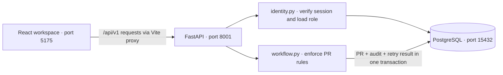
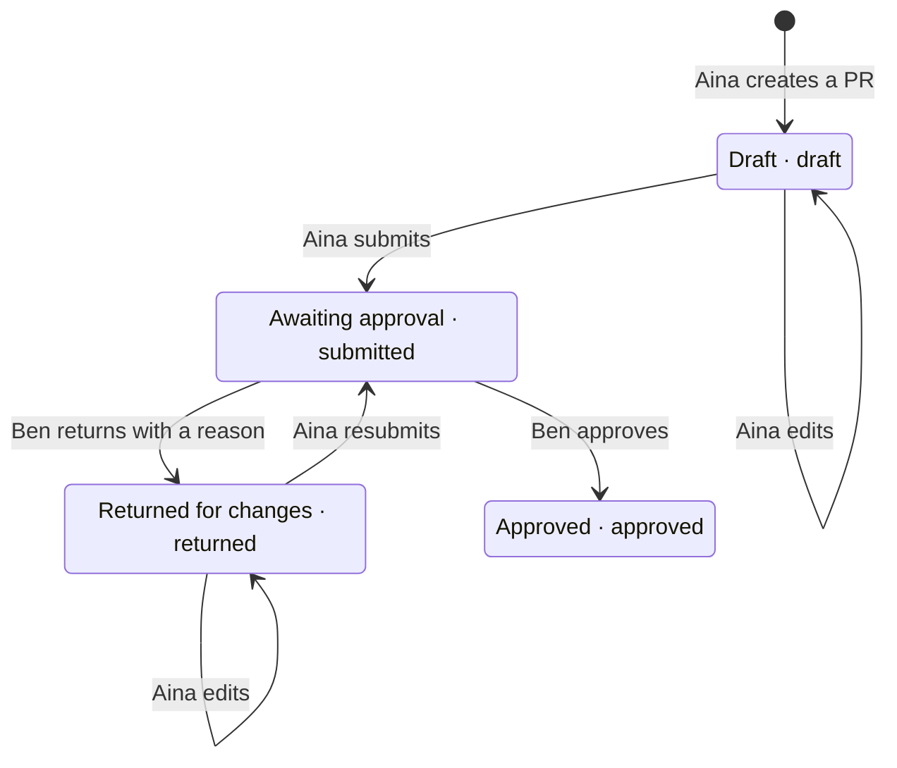

# First application slice: durable PR and approval

Implemented 23 October 2026 following the user's instruction to implement here and defer configuring another harness. The register layout is the delivery-team choice based on the preceding recommendation, not a claim that the user explicitly selected a prototype variant. The full milestone remains open.

The initial PO issuance extension is now documented in [purchase-order-slice.md](purchase-order-slice.md). The remaining-scope statements below describe the original PR slice.

## See the implemented boundary

The browser displays records. FastAPI decides who can change them. PostgreSQL owns the durable state. These are the components running now; Blob ingestion and the agent are later work.



The proxy keeps browser API requests on the workspace origin. Identity and workflow are modules in the same backend process, not separate services.

## See the PR states

Status answers “what can happen next?” Version answers “has this record changed since I opened it?” Every saved edit or transition increments the version.



Approved ends the currently implemented PR flow. Chloe's next handoff is shown in the UI; issuing a PO is not implemented yet. Returned requests stay `returned` while being edited, until Aina explicitly resubmits them.

## Try the application

Open http://127.0.0.1:5175/?theme=dark. This is the real application; the existing port 5173 prototype and learning pages remain separate.

Five seeded usernames: `aina`, `ben`, `chloe`, `dinesh`, `eva`. Each uses the local demonstration password `harbor-demo`. These are deliberately synthetic accounts for this loopback learning environment, not organizational identity.

1. Sign in as Aina. Create a goods PR for ten pump seals at MYR 200 each. Save, inspect the MYR 2,000 estimate and submit.
2. Sign out; sign in as Ben. Open the submitted request and return it with a reason.
3. Sign in as Aina. Edit the returned request, save and resubmit.
4. Sign in as Ben and approve. The activity history records every handoff, actor and version.
5. Sign in as Chloe. Inspect the approved PR. PO creation is a later slice.

The register also supports search, status filtering, multiple estimate lines, whole-count service milestones and light/dark themes. Browser checks left synthetic test PRs so that there is history to inspect.

For a guided introduction to the building blocks, use [Lesson 02: React and FastAPI components](../learnings/lessons/0002-react-fastapi-components.html) and its [component reference map](../learnings/reference/application-components.html).

## Code walkthrough

| Module | Responsibility |
|---|---|
| `backend/procurement/app.py` | Versioned HTTP routes, request correlation, error handling, origin/CSRF boundary and wiring |
| `backend/procurement/contracts.py` | Validated login, PR estimates, line items and versioned commands |
| `backend/procurement/identity.py` | Seeded identities, salted PBKDF2 passwords, signed sessions and database role resolution |
| `backend/procurement/config.py` | Local settings and persisted signing material |
| `backend/procurement/database.py` | Transaction boundary and checksummed SQL migrations |
| `backend/migrations/001_requisitions.sql` | Users, sessions, PRs, audit events and idempotency results |
| `backend/procurement/workflow.py` | Visibility, transitions, exact decimal totals, version checks, idempotency and audit writes |
| `frontend/src/main.tsx` | Login and API-backed register, detail, draft and approval forms |
| `frontend/src/style.css` | Responsive register/detail layout using installed Atlassian theme tokens |
| `backend/tests/test_requisitions.py` | Public HTTP tests against real PostgreSQL, including contention and restart behavior |

### Follow one approval through the code

Ben opens a submitted PR at version 2 and clicks **Approve PR**. The browser sends `expected_version: 2`, a command key and CSRF header; the session cookie travels automatically.

```text
App.transition("approve")                       frontend/src/main.tsx
  api("/requisitions/{id}/approve", "POST", ...)
    boundary                                   app.py
      check the request origin
      identity → authenticate                  identity.py
        verify signature and expiry
        load active session + current role     PostgreSQL
      actor                                    app.py
        verify CSRF token
      approve → command("approve")             workflow.py
        begin database transaction             database.py
        lock this actor + command key
        if identical command already succeeded
          return its saved response
        lock and load the visible PR
        check approver role and prevent self-approval
        check expected_version == current version
        check status == submitted
        set status = approved, version = 3
        append Ben's approval audit event
        save this command's response
        commit all three writes together
  refresh() → GET /requisitions
    display the saved state and activity
```

This sketch shows the successful business path and retry branch; FastAPI also validates the request contract. The browser cannot choose Ben's effective role by changing request data.

### Why retry keys and record versions are different

| Situation | What the API does | Why |
|---|---|---|
| Ben retries the same successful command, with the same key and body | Returns the original saved response | Avoids a second update or audit event, even though the version has since advanced |
| Ben reuses that key for a different command/body | Returns 409 | A key must identify one command |
| Two distinct approval commands both expect version 2 | One commits version 3; the other returns 409 | The PR row lock serializes them; the second sees that its version is stale |

```text
transaction
  update PR
  append audit event
  store retry result
if all succeed
  commit
else
  roll back every write
```

The row lock protects competing PR updates. The actor/key lock protects duplicate commands. Both are database locks held within the transaction, not browser flags.


## HTTP contract

Base path: `/api/v1`. OpenAPI: http://127.0.0.1:8001/docs.

| Route | Behavior |
|---|---|
| `POST /auth/login` | JSON username/password; sets HttpOnly session cookie and returns user + CSRF token |
| `GET /auth/me` | Restore authenticated user and CSRF token |
| `POST /auth/logout` | Revoke the database session and clear cookie |
| `GET /requisitions` | List PRs visible to the authenticated identity |
| `GET /requisitions/{id}` | PR detail, version and activity |
| `POST /requisitions` | Requester creates a validated draft |
| `PUT /requisitions/{id}` | Owner/requester edits a draft or returned PR |
| `POST /requisitions/{id}/submit` | Owner/requester submits a draft or returned PR |
| `POST /requisitions/{id}/return` | Approver returns a submitted PR with a nonblank reason |
| `POST /requisitions/{id}/approve` | Approver approves a submitted PR; self-approval forbidden |

PR payload: title, goods/service kind, purpose, vessel, location, required date, optional supplier suggestion and 1–20 lines (description, quantity, unit price). Currency is MYR. Service quantities are whole milestone counts. Tax modelling is outside this contract.

All PR mutations require `Idempotency-Key`; all authenticated mutations also require `X-CSRF-Token`. Edits/transitions require `expected_version`. The same actor/key/body replays its saved result without another update or audit event; key reuse for a different command is 409. A stale version or illegal state transition is 409. Invalid fields/reason are 422. Missing/invalid sessions are 401, disallowed actions 403, and invisible/missing records 404. Error responses include a request ID. Decimal quantities/prices/totals serialize as strings; calculations use decimal arithmetic and round each line to two places, half up.

## Identity and visibility

Signed HS256 tokens contain subject, session ID, CSRF value, issuer, audience and one-hour expiry. Roles are loaded from PostgreSQL on each request and are not trusted from token or request fields. Sessions can be revoked, and inactive users fail authentication. The HttpOnly, SameSite=Lax cookie is scoped to `/api`; Secure is disabled only for the current local HTTP environment. The signing key is generated once in ignored `backend/.local/session.key` unless supplied by configuration, and survives application restarts.

Aina can see her own PRs. Ben, Chloe, Dinesh and Eva can see submitted, returned and approved team records, but not other users' drafts. Only the requester can create/edit/submit; only Ben's approver role can approve/return. All first-team submitted requests route to Ben; no amount threshold or automatic approval is introduced. Each service line represents one named milestone or a repeated milestone count; accepting service work remains later scope.

## Verification

- 21 tests passed across the backend suite, including the four existing provider-error contracts. New PR tests use real PostgreSQL in a temporary schema and remove that schema after the run.
- Tested unknown/incorrect login, role injection, private draft visibility, all five roles, self-approval, CSRF/origin denial, modified/expired/revoked tokens, exact monetary arithmetic and invalid precision/quantity inputs.
- Tested return/edit/resubmission, stale versions, repeated commands and two competing approvals: exactly one approval committed.
- API/test-client recreation and a separate actual Uvicorn stop/start preserved the signed session, approved record and complete audit history. See `runtime-results/application-tests.xml` and `application-restart.json`.
- TypeScript check and frontend production build passed.
- Real browser walkthrough passed create → reload → submit → return → edit → resubmit → approve, activity display, buyer read-only controls, both themes and 390px page-overflow check, with no browser page errors. The reusable smoke script is `tools/check-application.cjs`; it uses an installed Playwright module (optional first CLI argument is the module path) and Chrome. Screenshots: `mockups/application-pr-dark.png`, `application-pr-light.png`, `application-pr-mobile.png`.
- The browser exercise found a populated textarea's label was ambiguous for exact label lookup; it now uses an explicit label/control association. The complete walkthrough passed after the fix.

## Remaining scope and limits

PO issuance/revision, goods receipt/service acceptance, invoices, document ingestion, agent tools, retrieval and RAG quality evaluation remain unimplemented. The assistant area communicates that boundary; it does not generate simulated answers in the real app. Agent-tool authorization cannot be marked verified before those tools exist. Existing hosted-provider probes remain separate from application/RAG quality results.

Production identity, HTTPS deployment, login abuse controls, database privilege hardening, pagination/load qualification and operational resilience remain later work. There is no claim of production readiness or full milestone completion. Package installation retains the previously observed legacy React peer warnings in transitive Atlaskit packages; the actual type/build/browser checks passed.
