# PO revision and reapproval

Implemented 24 October 2026 for the local mocked procurement application. This completes the PO workflow portion; receipts are now implemented in the [receiving slice](receiving-slice.md); invoices and the real RAG pipeline remain pending.

Chloe submits complete proposed terms → Ben approves or returns them → Chloe issues the exact approved proposal. Every proposal requires review, including decreases or supplier-only changes. A pending or approved proposal does not replace an issued order. Returned proposals remain readable; Chloe submits a new proposal rather than editing reviewed history.

The same flow handles increases before the first PO: submit a proposal from an approved PR, obtain Ben’s approval, then issue revision 1. Direct first issuance remains available for unchanged scope and prices within the original approved line ceilings, provided there is no open proposal.

## Try it

Open the real application at `http://127.0.0.1:5175/?theme=dark`. Local demo accounts use password `harbor-demo`.

1. As Chloe, open an approved request and use the highlighted action panel below the title: **Revise PO** for an issued order, or **Propose changed terms** before first issuance. It starts from the current issued terms, or the PR if no PO exists. Change supplier, scope, quantities or prices and give a reason.
2. As Ben, choose **Review PO proposal** in the top action panel and inspect the complete proposal alongside the current PO. **Return PO proposal** requires a reason. **Approve PO terms** authorizes the frozen proposal but leaves current issuance unchanged.
3. As Chloe, choose **Review and issue approved terms** in the top action panel, then **Issue approved PO terms**. The new revision becomes current. Expand **Issued history** to inspect all earlier revisions.

The register identifies Ben while review is pending, Chloe after approval, and Dinesh after issuance. The original PR estimate and approval status remain visible and unchanged. Scope changes may include goods/service type, location, due date, descriptions and lines; all replacement terms receive review. No supplier email or external purchasing action is sent.

## Follow the code

```text
frontend/src/main.tsx
  RequisitionForm(proposal=true) collects complete replacement terms
  save() → POST po-proposals
frontend/src/POReview.tsx
  renders proposal terms, review actions and issued history
  callback → POST po-proposals/{approve|return|issue}
backend/procurement/app.py
  signed session + CSRF + idempotency key + Pydantic body
backend/procurement/workflow.py: command()
  lock actor/key; replay identical retry
  lock PR; check role, version and approved PR state
  proposal_command()
    propose: save immutable terms and pending status
    approve/return: record named reviewer, time and reason
    issue: append exactly the approved terms as a new revision
  increment PR version; append audit; save retry response
  commit all writes together
```

```mermaid
stateDiagram-v2
    [*] --> Pending: Chloe submits terms
    Pending --> Returned: Ben returns with reason
    Returned --> [*]: Preserved; submit a new proposal
    Pending --> Approved: Ben approves
    Approved --> Issued: Chloe issues exact terms
    Issued --> [*]: New immutable revision becomes current
```



Current issuance changes only on the **Approved → Issued** transition. Its revision number is separate from the PR command version, which advances for every proposal/review/issuance to detect stale screens.

## HTTP contract

All paths start with `/api/v1/requisitions/{id}`. Mutations require the signed session cookie, `X-CSRF-Token`, `Idempotency-Key` and current `expected_version`.

| Method/path | Role | Body beyond version |
|---|---|---|
| POST `/po-proposals` | Buyer | Complete `RequisitionData`, confirmed `supplier`, `delivery_terms`, required `reason` |
| POST `/po-proposals/approve` | Approver, neither requester nor proposer | `proposal_id`, optional `reason` |
| POST `/po-proposals/return` | Same approver boundary | `proposal_id`, required `reason` |
| POST `/po-proposals/issue` | Buyer | `proposal_id`; changed terms cannot be supplied |

Responses are the refreshed PR with `purchase_order` (current), `po_history` (issued revisions in ascending order) and `po_proposals` (latest first). GET `/api/v1/purchase-orders/{id}` resolves the current revision of the stable PO identity. Historical snapshots are available through the authorized PR detail; a PO identity is stable across revisions. Requesters see only their own PRs and associated proposals/history.

## Storage and consistency

Migration `003_po_reapprovals.sql` adds proposal and revision tables without changing applied migrations 001/002. Revision 1 stays in immutable `purchase_orders`; revisions 2 onward are appended to immutable `po_revisions`. Current terms are derived from the highest issued revision. A database trigger protects proposal terms against edits or deletion while review status and decision metadata can advance through backend commands.

A partial unique index permits only one pending/approved proposal per PR. PR row locks serialize competing commands, and actor/key locks make identical retries replay their saved response. Database uniqueness guards revision numbers. Proposal changes, issuance, PR version, audit and retry response share one transaction.

Proposals record `source_pr_version` as provenance, not approval evidence. The proposal’s named reviewer, decision timestamp and audit events are the evidence of reapproval. Initial direct issuance retains its original `approved_pr_version` provenance field.

## Verification and limits

Backend HTTP integration tests use isolated real PostgreSQL schemas, with no mocked persistence. They cover increased scope/value, first issuance after reapproval, return/new review, exact snapshot issuance, revision history, role and self-approval rejection, stale/wrong proposal IDs, command replay, competing issuance, database immutability, app recreation, validation/CSRF and injected audit failure with rollback and retry. All 39 backend tests passed. See `runtime-results/application-tests.xml` for the recorded run. Actual API process restart preserved the authenticated PR, proposals and issued history (`runtime-results/po-revisions-restart.json`).

The reproducible browser script is `tools/check-po-revisions.cjs`; its sanitized report is `runtime-results/po-revisions-browser.json`. It creates a uniquely named synthetic fixture through the application and exercises review, return, replacement, issuance, reload, earlier history, themes and mobile layout.

This slice does not implement cancellation/withdrawal or external supplier delivery. Ben can now return either a pending or approved proposal with a reason. Receipt-aware revision constraints and revalidation at issuance are implemented in the [receiving slice](receiving-slice.md); invoice-aware constraints remain future work. The full milestone remains open for implementation and user code inspection.

25 October 2026: moved the next PO action to a highlighted panel immediately below the request title. ADS primary buttons and explicit owner/status text make actions discoverable in both themes. Review links scroll to and focus the full proposal; approval still happens after inspecting its terms.

26 October 2026: register badges and status filters now use the current workflow handoff from `frontend/src/workflowDisplay.ts`. Pending PO proposals display **Awaiting PO approval** even though the PR remains approved. Approved proposals display **PO approved · Ready to issue**; rows show the next action and owner. Filters include counts. `tools/check-workflow-status.cjs` verified Ben’s pending filter, matching detail badge, next-action text and reachable approval controls in both themes and at 390px; see `runtime-results/workflow-status-browser.json`.
